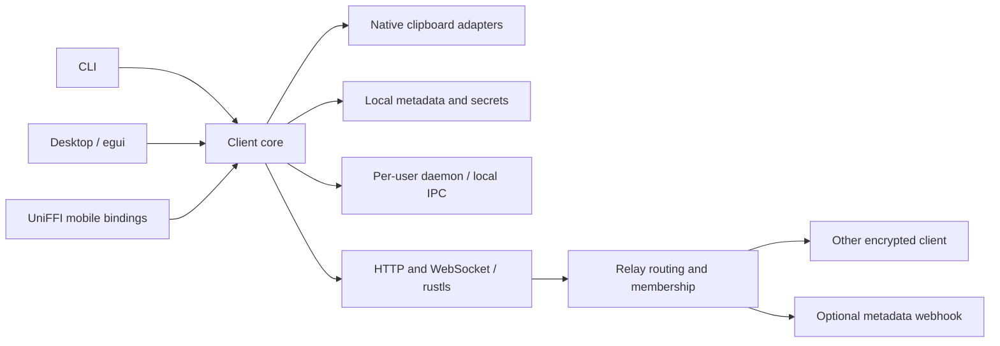

# Architecture

This repository contains the Rust workspace and support/packaging scripts.
Separate iOS and Android application repositories are outside this assessment;
the shared UniFFI binding library in this workspace is included.

The protocol crate defines shared message types, IDs, frame encodings and
limits. Crypto implements SPAKE2 pairing, transcript confirmation, device keys,
HKDF, AES-GCM, Noise and epoch wrapping. Transfer sanitizes received filenames,
validates manifests, and stages/reassembles chunks. Core coordinates these
components, sync direction, loop suppression and command behavior.

Storage manages configuration, room/peer metadata, private credentials and
received files. Clipboard and daemon crates contain the OS-specific boundary
with native services, clipboard tools and per-user service installation. The
desktop and CLI use the same core; mobile exports it through UniFFI.

## Data flows and boundaries

1. Two clients exchange a short-lived pairing offer through the relay and use
   the separately shared code for SPAKE2. Transcript/key confirmations and
   sender-specific binding nonces protect credential establishment. The relay
   sees routing and session metadata, not the resulting room secret.
2. The sender reads local clipboard/file input, validates size and type,
   encrypts a manifest and payload chunks, and sends them through transport.
   The relay checks membership, token and envelope constraints, then routes
   ciphertext. The peer validates and decrypts before writing clipboard/inbox
   data. Encrypted text has a bounded short-lived latest-message cache;
   file/image data is forwarded without relay-side assembly or disk storage.
3. The daemon exposes local commands through a per-user IPC endpoint. Local
   processes with the user's access are part of the endpoint trust assumption.
4. Optional webhooks send metadata to a configured external server. Destination
   resolution is a separate untrusted network boundary and must enforce the
   same public-address policy on every delivery.

See [interfaces](interfaces.md) for concrete request/error schemas,
[protocol](protocol.md) for framing and limits, and
[security requirements](security.md) / [assurance](assurance-case.md) for
assumptions and evidence. Current room epoch keys persist until re-pairing;
transport handshakes do not provide forward secrecy for stored payloads.
